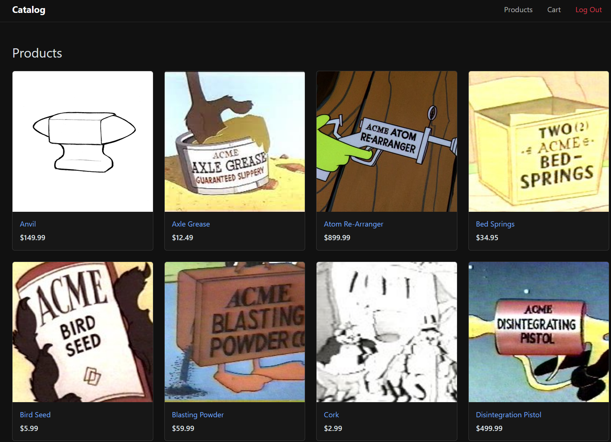

# Catalog: PHP & MySQL Storefront

A full-stack e-commerce storefront built with PHP and MySQL. Users create an account, log in, browse a product catalog, view product details, and manage a shopping cart with live-updating totals before checking out.

<!-- Add a screenshot: save one as docs/screenshot.png and uncomment the line below -->
<!--  -->

## Features

- **User accounts**: registration and login backed by a MySQL `users` table, with passwords hashed via PHP's `password_hash()` / `password_verify()` and session-based authentication
- **Protected pages**: catalog, product and cart pages redirect to login when no one is signed in
- **Product catalog**: products are loaded from the database and rendered as a responsive Bootstrap card grid
- **Product detail pages**: `product.php?id=N` with validated, type-cast IDs and a "product not found" state
- **Shopping cart**: add, update quantity, remove, clear and checkout, with the cart kept in the PHP session
- **Live totals**: vanilla JavaScript recalculates line totals, subtotal, tax and total as quantities change, then syncs them to the server on submit
- **Client-side validation**: password strength and confirmation checks on sign-up, alongside server-side checks
- **Security basics**: every query uses prepared statements (`mysqli`), all output is escaped with `htmlspecialchars`, and database credentials stay out of version control

## Tech Stack

| Layer    | Technology                        |
| -------- | --------------------------------- |
| Backend  | PHP 8, MySQL / MariaDB (`mysqli`) |
| Frontend | HTML, Bootstrap 5.3, JavaScript   |
| Server   | Apache (XAMPP)                    |

## Project Structure

```
catalog/
├── index.php              # Login / home page
├── create-account.php     # Registration
├── catalog.php            # Product grid
├── product.php            # Product detail
├── cart.php               # Cart + checkout logic
├── logout.php
├── includes/
│   ├── database.php       # DB connection and all queries (prepared statements)
│   ├── functions.php      # Rendering helpers and routing
│   └── config.example.php # Credential template
├── js/
│   ├── cart.js            # Live cart totals
│   └── create-account.js  # Password validation
├── css/style.css
├── img/                   # Product images
└── database/schema.sql    # Tables and sample products
```

## Running Locally

1. Install [XAMPP](https://www.apachefriends.org/) (or any Apache + PHP 8 + MySQL setup).
2. Clone this repo into your web root:
   ```bash
   cd C:/xampp/htdocs        # macOS: /Applications/XAMPP/htdocs
   git clone https://github.com/matgmarcelino/php-catalog-store.git catalog
   ```
3. Start **Apache** and **MySQL** from the XAMPP control panel.
4. Create the database by importing `database/schema.sql` in phpMyAdmin (`http://localhost/phpmyadmin`), or run:
   ```bash
   mysql -u root -p < database/schema.sql
   ```
5. Copy the config template and add your MySQL credentials:
   ```bash
   cp includes/config.example.php includes/config.php
   ```
6. Visit `http://localhost/catalog`, create an account, and start shopping.

> **Upgrading from an earlier version?** Passwords used to be stored as salted SHA-512 hashes and are now stored with `password_hash()`. Accounts created before the change can't log in, so clear them (`DELETE FROM users;`) and sign up again.

## What I Learned

- Structuring a multi-page PHP app around shared includes for data access and rendering
- Preventing SQL injection with prepared statements, and XSS with output escaping
- Managing authentication state and cart data with PHP sessions
- Keeping client-side JavaScript and server-side state in sync

## Possible Improvements

- Add CSRF tokens to forms
- Save orders to an `orders` table instead of only clearing the cart on checkout
- Reuse a single database connection per request
